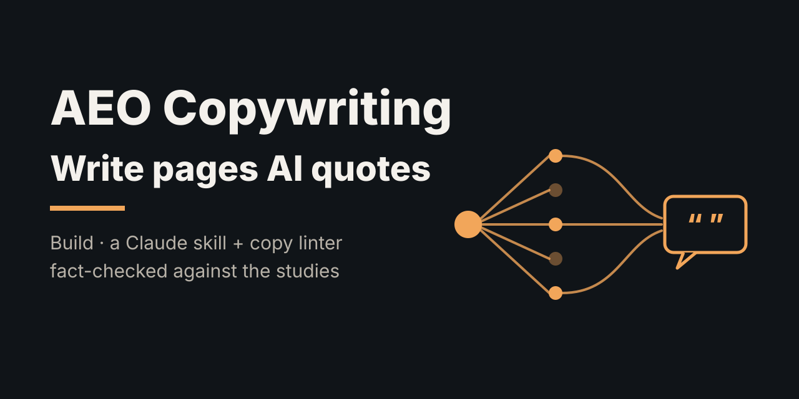
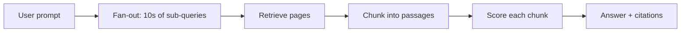
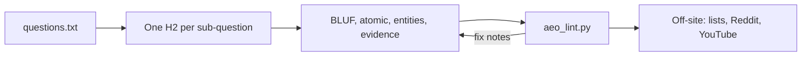

# AEO Copywriting: How to Write Pages AI Answer Engines Quote

> **TL;DR:** Ahrefs' 19-minute AEO video holds up: most of its stats trace back to real Ahrefs studies. They're correlations from the company selling the tool, though, and a few only apply to Google, not ChatGPT. The copy part is the most useful bit, so I turned it into a Claude skill plus a small linter. It checks whether each section of a page answers first, stands on its own, names real things, and brings evidence.

**Spark:** [Learn 80% of AEO in 19 Minutes (Ahrefs)](https://youtu.be/58MR03s0ev8) · **Angle:** build · **Date:** 2026-10-14

## Get the skill

The skill lives in [`skill/`](skill/SKILL.md): a `SKILL.md` for Claude plus the linter in `skill/scripts/`. To install it for Claude Code:

```bash
git clone https://github.com/maxsancheez/aeo-copywriting-skill /tmp/aeo-skill && mkdir -p ~/.claude/skills/aeo-copywriting && cp -r /tmp/aeo-skill/skill/* ~/.claude/skills/aeo-copywriting/
```

Then ask Claude something like "make this page AEO-ready" or "why doesn't ChatGPT mention my brand?" and it'll pick the skill up. It starts by finding your biggest gap (citation, topic, competitor or format), then maps the fan-out, writes the copy and lints it.

## The claim vs. reality

The video (Sam Oh for Ahrefs) splits answer engine optimization into five pieces: how AI search works, a brand gap analysis, prompt research, getting cited, and measurement. The core idea is that one ChatGPT prompt fans out into lots of smaller searches. So you need to cover a whole topic, get your brand named on other sites, and write in a way AI can lift cleanly.

Here's how the headline numbers check out:

| Claim in the video | What I found | Verdict |
|---|---|---|
| 76% of AI Overview citations come from Google's top 10 | 76.1% across 1.9M citations from 1M AI Overviews [3] | ✅ but Google only |
| Ranking well gives you a head start in AI | For ChatGPT, Gemini and Copilot only about 12% of cited URLs rank top 10 for the same prompt; Perplexity is 28.6% [4] | ⚠️ much weaker outside Google |
| AI-cited content is 25.7% fresher | Average age 1,064 vs 1,432 days, across ~17M citations. By last-update date the gap is only 13.1% [5] | ✅ with a smaller real gap |
| Branded web mentions correlate best with AI Overview visibility | 0.664 across 75K brands, beating backlinks and DR [6] | ✅ correlation, not cause |
| YouTube mentions correlate 0.737 with ChatGPT visibility | Ahrefs' Dec 2025 follow-up puts YouTube mentions top at ~0.737 [7] | ✅ correlation, not cause |
| 43.8% of ChatGPT-cited pages are "best X" lists | 43.8% of page types across 26,283 source URLs from 750 prompts [8] | ✅ |
| AI Overviews hit 21% of keywords, ~58% of questions, 99.9% informational | 20.5% of 146M SERPs, 57.9% of question queries [9] | ✅ |
| 5.9% of ~140M sites block GPTBot | 5.89%, robots.txt only, so firewall blocks aren't counted [10] | ✅ |
| AI search was 0.5% of Ahrefs' traffic and 12.1% of signups | True for one 30-day window on one site [11] | ✅ but n = 1 |
| Start sections with the answer because models weight the start and end | Matches "Lost in the Middle": accuracy drops when the key info sits mid-context [2] | ✅ peer-reviewed |

The video leaves out the other side. When Google shows an AI Overview, people click a regular result 8% of the time vs 15% without one, and they click a link inside the summary about 1% of the time [12]. That's why the video's "get mentioned, not clicked" goal for informational queries makes sense. And Google itself says AI Overviews need no special markup or `llms.txt`, just normal SEO hygiene [13].

## How it works

An answer engine doesn't read your page top to bottom. It splits the prompt into sub-searches, pulls chunks from lots of pages, and writes one answer.



So the copy job splits into two loops. On your site, each chunk has to win on its own. Off your site, you want enough other pages naming you that the model trusts what it reads.



## Deep dive

### Why the writing rules work

The video gives four micro rules: bottom line up front, atomic sections, entity-rich writing, and simple declarative sentences. Two of them have real research behind them.

Lead with the answer. Liu et al. tested models on multi-document QA and found accuracy is highest when the relevant info sits at the start or end of the input, and drops when it's in the middle [2]. A retrieved chunk that opens with backstory pushes the answer into the middle.

Bring evidence. The GEO paper (Princeton and others, KDD 2024) built a 10,000-query benchmark and tested ways of rewriting source pages. Adding citations, quotations and statistics did best, raising a source's visibility in generated answers by up to about 40% [1]. That's a relative score inside their test setup, not traffic, and the effect varied by domain. Still, it's the only controlled experiment in this whole space, so I made "evidence" one of the five checks.

Atomic sections and entity density are the video's own advice. They follow from how retrieval works (you don't control where a page gets chunked), but I didn't find a controlled study for them.

### What's correlation and what's cause

Almost every number in the video comes from Ahrefs analyzing its own Brand Radar data. The studies are big (75K brands, 17M citations) and they say plainly that correlation isn't causation [6][7]. Ahrefs also sells the tools the video demos. None of that makes the numbers wrong. It just means "YouTube mentions correlate 0.737" could partly mean "big brands get talked about on YouTube and also get named by ChatGPT."

### Where the Google stats don't carry over

The "76% from the top 10" stat is about Google AI Overviews. Ahrefs' own later study found ChatGPT, Gemini and Copilot cite pages outside Google's top 10 for the same prompt most of the time [4]. That fits the fan-out idea: they're ranking for sub-queries, not your head term. So SEO is the floor for AI Overviews, and topic coverage plus off-site mentions matter more for the chatbots.

### The technical stuff

GPTBot is the most-blocked AI crawler at 5.89% of sites [10]. Cloudflare started defaulting new domains toward blocking AI crawlers in July 2025 [14], so check settings even if you never touched robots.txt.

## Apply it

There are two pieces: the skill (`skill/SKILL.md`) and the linter (`code/aeo_lint.py`).

**The skill** walks Claude through nine steps: find the biggest gap, map the fan-out, run the AI filter on each sub-question, set up the page, write each section by the rules, draft off-site copy (listicle pitches, Reddit answers, YouTube titles), do the robots.txt check, lint, and set up measurement. It has guardrails against invented stats and astroturfing. To install it:

```bash
git clone https://github.com/maxsancheez/aeo-copywriting-skill /tmp/aeo-skill && mkdir -p ~/.claude/skills/aeo-copywriting && cp -r /tmp/aeo-skill/skill/* ~/.claude/skills/aeo-copywriting/
```

**The linter** treats each H2/H3 as a chunk and scores it on BLUF, atomic opening, entity density, sentence length and evidence. Then it checks for a visible updated date, a list or table, and which fan-out questions no section covers. Here's a fluffy cold brew page (fictional brand) before the rewrite:

```
AEO score: 29/100   (samples/before.md)
  updated date: missing  <- add or refresh a visible 'Updated' date
  list/table:   no  <- add a list, table or comparison

  section                            score  bluf  atom   ent  simp  evid
  (intro)                               20   0.2   1.0   0.0   0.0   0.0
  Why cold brew?                        30   0.2   1.0   0.0   0.5   0.0
  How long should it steep?             26   1.0   0.0   0.0  0.04   0.0
  Storing it                            50   1.0   0.3   0.0   1.0   0.0

  - [Why cold brew?] opens with a question; answer it in sentence 1
  - [Why cold brew?] vague phrases: Our product, a lot of, game-changer, this tool
  - [How long should it steep?] starts with a back-reference ("This"); name the subject
  ...
  fan-out coverage: 5/6 sub-questions answered
    GAP cold brew coffee to water ratio  (best match 33%)
```

And after rewriting it by the skill's rules:

```
AEO score: 96/100   (samples/after.md)
  updated date: 2026-10-01 (13 days old)
  list/table:   yes

  section                            score  bluf  atom   ent  simp  evid
  (intro)                               90   1.0   1.0   1.0   1.0   0.5
  How long should cold brew steep?     100   1.0   1.0   1.0   1.0   1.0
  What ratio of coffee to water shou   100   1.0   1.0   1.0   1.0   1.0
  What grind size works for cold bre    80   1.0   1.0   1.0   1.0   0.0
  How long does cold brew last in th   100   1.0   1.0   1.0   1.0   1.0
  Cold brew vs. iced coffee            100   1.0   1.0   1.0   1.0   1.0

  - [What grind size works for co] no stat, quote or citation; add one

  fan-out coverage: 6/6 sub-questions answered
```

The before page "covers" 5 of 6 questions because coverage is keyword overlap. A section that mentions grind size without giving one still counts. Read the `ok` lines, don't trust them blindly.

## Assumptions

| Parameter | Value | Anchored to |
|---|---|---|
| BLUF weight | 25 | Lost in the Middle [2], plus the video. Weight is an illustrative guess |
| Evidence weight | 20 | GEO paper [1]: stats/quotes/citations were the top tactics. Weight is a guess |
| Atomic weight | 15 | Video's chunking argument. Illustrative guess |
| Entities and simple weights | 20 each | Video's advice. Illustrative guess |
| Long sentence | > 25 words | Illustrative guess |
| Entity target | 6 per 100 words | Illustrative guess, tuned on the samples |
| Evidence target | 2 per section | Illustrative guess |
| Freshness window | 365 days | Loosely from Ahrefs' freshness study [5]; the video says ChatGPT favors pages refreshed in the last 30 days |
| Coverage threshold | 60% of non-seed words | Illustrative guess |

## Takeaways

- Write one section per sub-question, and make sentence one the answer.
- Put a stat, a named quote or a citation in every section that claims something. That's the tactic with the best evidence.
- For informational queries, aim to get named in the answer, since clicks drop from 15% to 8% when an AI Overview shows.
- Most AI mentions come from other people's pages. Pitch "best X" lists, answer real Reddit threads, and get on YouTube.
- Check robots.txt and Cloudflare before writing anything, and ask "How did you hear about us?" at signup.

## Open questions

- No public controlled test yet shows atomic sections or entity density causing more citations. A/B testing two versions of a page against a fixed prompt set would settle it.
- The GEO benchmark used 2023–2024 engines. Nobody's re-run it on current ChatGPT search or AI Mode that I found.
- How much of the YouTube correlation is just brand size?
- AI referral numbers undercount, so self-reported attribution may be the only honest metric for a while.

## Sources

1. [Aggarwal et al., "GEO: Generative Engine Optimization", KDD 2024](https://arxiv.org/abs/2311.09735): the 10K-query benchmark; citations, quotes and stats boost visibility up to ~40%.
2. [Liu et al., "Lost in the Middle: How Language Models Use Long Contexts", TACL 2024](https://doi.org/10.1162/tacl_a_00638): models use info at the start and end of the context best.
3. [Ahrefs: 76% of AI Overview Citations Pull From the Top 10](https://ahrefs.com/blog/search-rankings-ai-citations/): 1.9M citations, 76.1% top 10.
4. [Ahrefs: Only 12% of AI Cited URLs Rank in Google's Top 10 for the Original Prompt](https://ahrefs.com/blog/ai-search-overlap/): 15K prompts; Perplexity 28.6%.
5. [Ahrefs: AI Assistants Prefer to Cite "Fresher" Content](https://ahrefs.com/blog/do-ai-assistants-prefer-to-cite-fresh-content/): ~17M citations; 25.7% by age, 13.1% by update.
6. [Ahrefs: AI Overview Brand Visibility Factors (75K Brands)](https://ahrefs.com/blog/ai-overview-brand-correlation/): branded web mentions 0.664.
7. [Ahrefs: Top Brand Visibility Factors in ChatGPT, AI Mode, and AI Overviews](https://ahrefs.com/blog/ai-brand-visibility-correlations/): YouTube mentions ~0.737.
8. [Ahrefs: Do Self-Promotional "Best" Lists Boost ChatGPT Visibility?](https://ahrefs.com/blog/best-lists-research/): 43.8% "best X" lists, 750 prompts.
9. [Ahrefs: What Triggers AI Overviews? 146 Million SERPs](https://ahrefs.com/blog/ai-overview-triggers/): 20.5% of SERPs, 57.9% of questions.
10. [Ahrefs: The AI Bots That ~140 Million Websites Block the Most](https://ahrefs.com/blog/ai-bot-block-rates/): GPTBot 5.89%.
11. [Ahrefs: 0.5% of Visitors Drove 12.1% of Signups](https://ahrefs.com/blog/ai-search-traffic-conversions-ahrefs/): one site, 30 days.
12. [Pew Research Center: Google users are less likely to click on links when an AI summary appears](https://www.pewresearch.org/short-reads/2025/07/22/google-users-are-less-likely-to-click-on-links-when-an-ai-summary-appears-in-the-results/): 8% vs 15% clicks, 900 US adults.
13. [Google Search Central: AI features and your website](https://developers.google.com/search/docs/appearance/ai-features): no special optimization needed for AI Overviews and AI Mode.
14. [MIT Technology Review: Cloudflare will now block AI bots by default](https://www.technologyreview.com/2025/07/01/1119498/cloudflare-will-now-by-default-block-ai-bots-from-crawling-its-clients-websites/): July 2025 default change.
